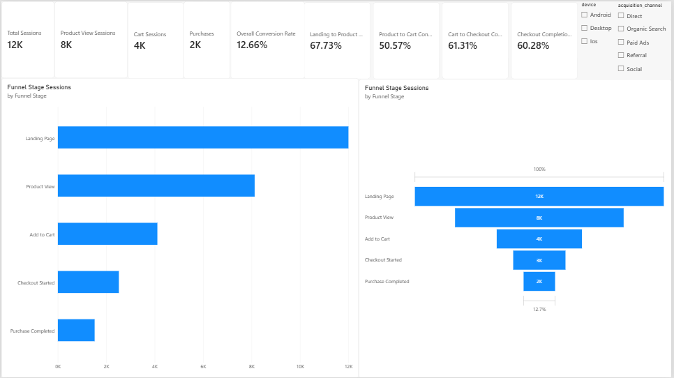
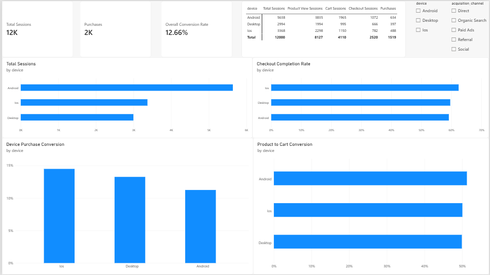

# Product Funnel & Conversion Analysis

## Project Overview

This project analyzes the e-commerce purchase journey using synthetic session and funnel-event data. The analysis examines how users progress through different stages of the purchase funnel, identifies major drop-off points, and compares conversion performance across devices and acquisition channels.

SQL is used for data preparation and analysis, while Power BI is used to build interactive dashboards and visualize funnel performance.

> **Disclaimer:** This project uses synthetic data for portfolio and learning purposes. It does not represent the performance of a real company or product.

## Business Problem

An e-commerce product team wants to understand where users abandon the purchase journey and why overall conversion may be lower than expected.

The analysis focuses on:

- Understanding user progression through the purchase funnel.
- Measuring conversion between consecutive funnel stages.
- Identifying the largest drop-off points.
- Comparing conversion performance across devices.
- Evaluating acquisition channel performance.
- Identifying opportunities to improve the user experience and purchase completion.

## Tools Used

- **SQL (SQLite):** Data preparation, data validation, session-level analysis, funnel conversion, and drop-off calculations.
- **Power BI:** KPI cards, funnel visualizations, conversion analysis, device comparisons, acquisition channel analysis, and trend dashboards.
- **Excel:** Dataset inspection and validation.

## Dataset

The project uses two synthetic datasets:

- `sessions_raw.csv` — session-level information, including session ID, user ID, device, acquisition channel, and session date.
- `funnel_events_raw.csv` — event-level information recording user interactions throughout the purchase journey.

The cleaned datasets are:

- `sessions_clean.csv`
- `funnel_events_clean.csv`

The funnel consists of five stages:

1. Landing Page
2. Product View
3. Add to Cart
4. Checkout Started
5. Purchase Completed

Session-level flags are used to identify whether each session reached a particular funnel stage. This avoids inflating funnel counts when the same event is recorded multiple times within a session.

## Key Findings

The Power BI report shows the following results for the supplied dataset:

- **12,000 total sessions** were recorded.
- **8,127 sessions** reached the product-view stage.
- **4,110 sessions** reached the add-to-cart stage.
- **2,520 sessions** reached checkout.
- **1,519 sessions** completed a purchase.
- The overall session-to-purchase conversion rate was **12.66%**.

### Funnel Conversion

- Landing Page to Product View: **67.73%**
- Product View to Add to Cart: **50.57%**
- Add to Cart to Checkout: **61.31%**
- Checkout Completion: **60.28%**

The product-view-to-cart transition has the lowest conversion rate among the consecutive funnel stages, making it an important area for further investigation.

### Device Performance

- iOS recorded the highest purchase conversion rate at approximately **14.49%**.
- Desktop recorded approximately **13.26%**.
- Android recorded approximately **11.25%**.

Android has the highest session volume but the lowest purchase conversion rate among the three devices.

### Acquisition Channel Performance

The report compares acquisition channels including Direct, Organic Search, Paid Ads, Referral, Social, and Unknown.

Organic Search contributes the highest session volume in the dataset, while Paid Ads shows comparatively weaker purchase conversion.

These findings highlight differences in traffic quality and conversion performance, but they do not establish the causes of those differences.

## Analysis Approach

1. Reviewed the raw session and funnel-event datasets.
2. Inspected and validated session IDs, event names, device categories, acquisition channels, and date fields.
3. Used SQL to prepare and standardize the datasets.
4. Created a session-level funnel table using distinct session identifiers.
5. Identified whether each session reached the five funnel stages.
6. Calculated total sessions, product views, add-to-cart sessions, checkout sessions, and purchases.
7. Calculated overall conversion and stage-to-stage conversion rates.
8. Measured drop-offs between consecutive funnel stages.
9. Compared funnel performance across devices and acquisition channels.
10. Analyzed session volume, purchases, and conversion trends over time.
11. Built interactive Power BI dashboards to present the findings.

## Dashboard Preview

### 1. Funnel Overview



### 2. Device Comparison



### 3. Acquisition Quality


### 4. Trend & Diagnostics


## Recommendations for Further Investigation

1. Investigate the product-view-to-cart transition to understand why a significant proportion of sessions do not add products to their carts.
2. Review the Android shopping experience, including navigation, page performance, product presentation, and cart usability.
3. Examine the checkout journey to identify potential friction in payment methods, form completion, and order confirmation.
4. Investigate the quality and intent of traffic arriving through different acquisition channels.
5. Compare conversion trends over time to identify periods of improvement or decline.
6. Conduct usability testing and controlled experiments before implementing major changes to the purchase journey.

These are proposed investigation steps, not confirmed causes of user drop-off.

## Limitations

- The dataset is synthetic and does not represent real e-commerce user behaviour.
- Funnel counts are based on sessions reaching each stage, not unique users.
- The analysis identifies associations and drop-off patterns but does not establish causation.
- A session reaching a later funnel stage is counted at that stage even if event ordering is not validated.
- Acquisition channel conversion differences do not account for campaign costs or customer lifetime value.
- Further investigation and real-world experimentation would be required before making product decisions.

## Project Structure

```text
product-funnel-conversion-analysis/
├── data/
│   ├── sessions_raw.csv
│   ├── sessions_clean.csv
│   ├── funnel_events_raw.csv
│   └── funnel_events_clean.csv
├── sql/
│   └── product_funnel_analysis.sql
├── powerbi/
│   └── product_funnel_conversion_analysis.pbix
├── docs/
│   └── dashboard-screenshots/
│       ├── funnel_overview.png
│       ├── device_comparison.png
│       ├── acquisition_quality.png
│       └── trend_diagnostics.png
└── README.md
```

## Skills Demonstrated

SQL data preparation, data validation, session-level analysis, funnel analysis, conversion rate calculation, drop-off analysis, device segmentation, acquisition channel analysis, time-series analysis, KPI development, Power BI dashboard development, and evidence-based product recommendations.
